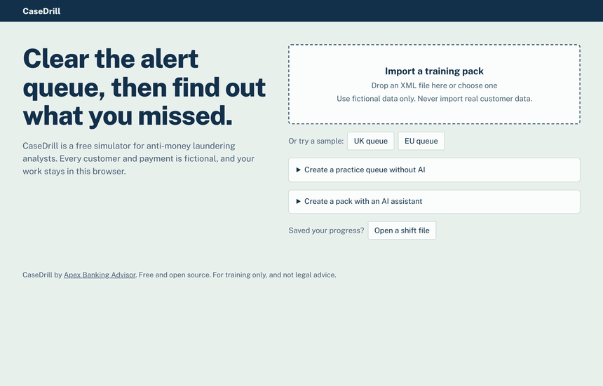

# CaseDrill

**Free money laundering (AML) analyst simulator that runs in your browser.** Work a queue of alerts, investigate fictional customers, decide what to send forward, write a guided report, and see exactly what you missed.

[**Open CaseDrill**](https://ghstlkr.github.io/casedrill/) (nothing to install, no account)



CaseDrill by [Apex Banking Advisor](https://apexbankingadvisor.com). All customers, companies and payments are fictional. Your work stays in your browser.

## What you practise

| Skill         | How CaseDrill trains it                                               |
| ------------- | --------------------------------------------------------------------- |
| Triage        | A queue of alerts, most of them false positives                       |
| Investigation | Customer profile, transactions, documents and a map of counterparties |
| Judgement     | Decide, flag the evidence and name the pattern                        |
| Routing       | Choose where the case should go, including options that are traps     |
| Reporting     | Assemble a report from good and bad text                              |
| Time          | A shift clock, and document requests that use up time                 |

At the end you get a score, your detection rate and precision, accuracy by pattern, and a case-by-case explanation of what you found and what you missed.

## Start in one minute

1. [Open CaseDrill](https://ghstlkr.github.io/casedrill/).
2. Under **Or try a sample**, choose **UK queue** or **EU queue**.
3. Read the summary and select **Start shift**.
4. Select a customer in the queue and work through the tabs.
5. When every alert has a decision, select **End shift**.

Every option has an **i** button that explains what it is, when to use it and a common mistake.

## Three ways to get training packs

### 1. Create one in the app

Select **Create a practice queue without AI**. Choose the jurisdiction, level, number of alerts, number of true positives and difficulty.

### 2. Create one with an AI assistant

CaseDrill never connects to an AI service. You make the file yourself:

1. Download [`casedrill-template.xml`](templates/casedrill-template.xml). The app has the same link.

2. Upload it to an AI assistant such as Claude.

3. Send this message, changing the numbers if you wish:
   
   > Fill in this CaseDrill template by following the aiInstructions block in the file. Use 15 alerts, 3 true positives, Level 2 and the UK. Return the complete XML as a file and do not describe the scenarios or answers in your message.

4. Import the returned XML into CaseDrill.

Keep files to about 20 alerts, so the AI's response is not cut off.

### 3. Use a shared pack

Import an XML file that someone else made, or try those in [`packs/curated`](packs/curated).

## How many alerts are true positives?

The number is fixed inside each pack and shown before you start, for example `True positives: 3 of 15 alerts (20%)`. An instructor can show a percentage range instead (see below).

## Something went wrong?

| Message                                                 | What to do                                                                                         |
| ------------------------------------------------------- | -------------------------------------------------------------------------------------------------- |
| The file appears to have been cut off                   | Ask the AI for fewer scenarios                                                                     |
| This file needs fixing                                  | Select **Copy message for the AI**, paste it to the AI that made the file, and import the new file |
| Contains something that looks like an IBAN (or similar) | Ask the AI to use fictional identifiers only                                                       |
| The answers could not be opened                         | The password is wrong or the file was changed                                                      |

## Hiding the answers from a trainee

The person who generates a pack can see its answers. To train someone else, import the pack and open **Seal this pack for someone else**.

| Option             | Protection                                                 | Use it for      |
| ------------------ | ---------------------------------------------------------- | --------------- |
| Without a password | Casual reading only, because CaseDrill's code is public    | Self-study      |
| With a password    | Real encryption. The password is not stored in the file    | Training groups |
| Password and range | As above, and the exact count of true positives is removed | Assessments     |

Share the `.sealed.xml` file and give out the password when the shift ends. A lost password cannot be recovered.

## Levels and jurisdictions

|              | Level 1: Alert triage | Level 2: Investigation                           |
| ------------ | --------------------- | ------------------------------------------------ |
| Decisions    | Close or escalate     | Close or refer to the MLRO or Compliance Officer |
| Documents    | On file only          | On file and on request                           |
| Network view | No                    | Yes                                              |
| Routing      | No                    | Yes                                              |
| Report       | Short note            | Guided report                                    |

Level 3 (the final reporting decision) is prepared in the file format but not yet available.

Jurisdictions are the **UK** (SAR, NCA, DAML) and the **EU**, modelled on Regulation (EU) 2024/1624. That regulation applies from 10 July 2027, and the EU profile uses a generic National FIU.

## Scoring

| Part     | Level 1 | Level 2 |
| -------- | -------:| -------:|
| Decision | 50      | 40      |
| Evidence | 25      | 25      |
| Routing  |         | 15      |
| Report   | 10      | 10      |
| Pattern  | 10      | 5       |
| Time     | 5       | 5       |

Parts that do not apply to a case are left out and the rest are rescaled. To pass you need 70 and no critical errors. Sending a true positive nowhere, or selecting the option to inform the customer, is a critical error and limits that case to 40.

## Install or use offline

- **Install:** open CaseDrill and use your browser's install option. It then works offline.
- **One file:** download `casedrill.html` from the [Releases page](https://github.com/ghstlkr/casedrill/releases) and open it. This suits computers where installing is restricted.

Progress is saved in your browser. Clearing browser data deletes it, so use **Save progress to a file** before a long break or to move to another device.

## Status of the content

CaseDrill is for education. It is not legal advice, a compliance tool or a certification.

The UK and EU material is simplified and has not been reviewed by a UK practitioner. NCA glossary codes are not included. If you work in this field, corrections are very welcome: please open an issue.

**Never import real customer data.**

## For developers

Requires Node.js 22.

```bash
npm ci
npm test
npm run dev -w @casedrill/web
```

| Package     | Purpose                                                            |
| ----------- | ------------------------------------------------------------------ |
| `schema`    | Pack format and validation rules                                   |
| `profiles`  | UK and EU rules, levels and the text of the **i** buttons, as JSON |
| `importer`  | Safe XML import and error messages                                 |
| `seal`      | Encryption of answer keys                                          |
| `engine`    | Reproducible transactions from a seed                              |
| `generator` | Practice queues without AI                                         |
| `scoring`   | Scoring, as pure functions                                         |
| `web`       | The React app                                                      |

See [CONTRIBUTING.md](CONTRIBUTING.md).

## License

Code: [MIT](LICENSE). Scenario packs: [CC BY 4.0](packs/README.md).
